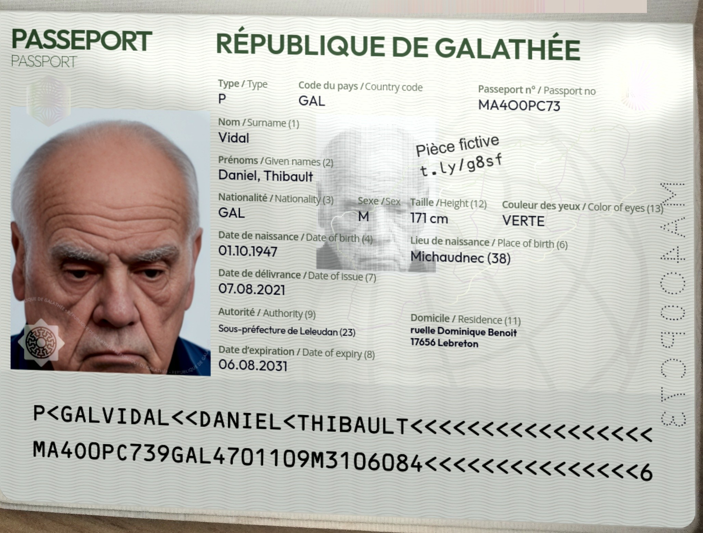
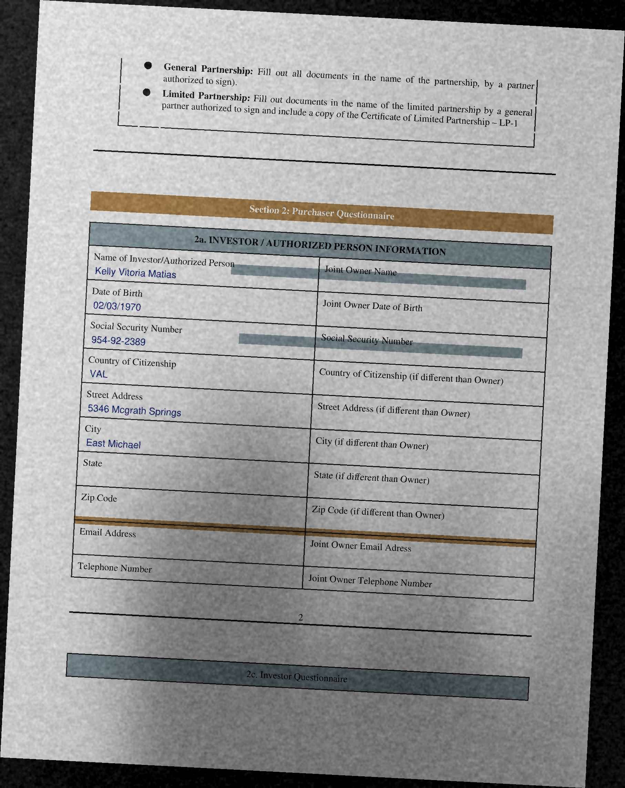

# maples_kyc_poc — Maples KYC Document Extraction (Proof of Concept)

McGill MMA Capstone with Maples Group, AML/KYC and Data Management.
**Synthetic and public data only.**

## What this does

This mimics an individual investor uploading an ID and a subscription agreement, as messy as real uploads are
(phone photos, scans, sideways, shadows). The pipeline then does:

```
uploads ──► classify ──► extract (2 methods per document) ──► validate ──► cross-check ──► Excel tracker
```

| Document | Method A | Method B |
|---|---|---|
| Passport / ID card (photo or scan) | MRZ: OCR, parse, verify check digits | Printed zone: find each MRZ value printed on the card |
| Subscription agreement (PDF, scan or photo) | PDF text layer | OCR (after flattening shadows and straightening the page) |

**Traffic light**

- 🟢 **Green**: two independent sources agree (two methods, or ID and subscription agreement)
- 🟡 **Amber**: one source only, sources disagree, or a check digit fails → analyst confirmation upgrades this to a green
- 🔴 **Red**: missing, expired, unreadable, or the subscription contradicts the ID → act on it

A check digit alone never earns green: it can't tell `G` from `6` (ICAO values 16 and 6 collide mod 10),
and it can flag an `O`/`0` misread without saying which one is right.

## Data

| Document | Source | Licence |
|---|---|---|
| Passports, ID cards | [DocXPand-25k](https://github.com/QuickSign/docxpand): fictional IDs with generated faces, photographed and scanned on real backgrounds, with an answer key for every field | CC BY-NC-SA 4.0 (non-commercial, credit the authors) |
| Subscription agreements | Blank Reg A subscription agreements (EX1A-4) from SEC EDGAR: Commune Omni Fund, CWS Investments, Red Oak Capital Fund VI, REI Capital Growth. Filled with the same synthetic person as the ID | Public filings |

We only use **blank** SEC forms. Executed agreements filed with the SEC contain real investors' details.

**How DocXPand images are made** (Lerouge et al., QuickSign, 2024): the document designs are fictional,
names and numbers come from `faker`, and faces are generated with Stable Diffusion. Each fictional
document is composited onto a real photo or scan of an ID (the real document is replaced at the same
position; signatures and numbers inpainted; every image reviewed by the authors for leaked personal data).
So the backgrounds, e.g. the facing page of a passport booklet, are real imagery; the identity is not.

**What's on GitHub:** all 40 investors in `data/demo/`, plus 6 of them in `samples/` with the IDs cropped
for a quick run. Maples confirmed that data from public online sources is fine to use. The DocXPand
images in this repo keep their licence (CC BY-NC-SA 4.0): credit the authors, non-commercial use only.

<p>
  
  
  
</p>

*From `samples/`: a passport, an ID card, and a subscription agreement filled with the passport holder's
details and made to look like a phone photo.*

Planted issues: date of birth, name or address on the subscription differing from the ID,
a date of birth left blank, and (from DocXPand itself) expired IDs.

## Run it

**1. Setup (once, ~5 min)**

```bash
brew install tesseract                 # Windows: UB-Mannheim build; Linux: apt install tesseract-ocr
python -m venv .venv && source .venv/bin/activate
pip install -r requirements.txt
```

**2. Run it (nothing to download, the data is in the repo)**

```bash
python run_pipeline.py                 # all 40 investors (~10 min) → writes output/kyc_tracker.xlsx
python run_pipeline.py samples         # or just the 6 samples (~2 min)
jupyter notebook notebooks/            # start with results.ipynb
```

**3. Only if you want to rebuild the test data (~1 hour, mostly download)**

```bash
python -m prepare.docxpand             # streams ~18 GB, keeps ~400 IDs; safe to stop and rerun
python -m prepare.build_demo           # rebuilds the 40 investors in data/demo/
```

## Repo layout

The folders follow the pipeline, in the order the data flows through it. Each stage is its own
folder or file, so one person can work on a stage without touching the others.

```
maples_kyc_poc/
│
├── run_pipeline.py        START HERE. Runs every stage below for each investor, in order
├── config.py              Business rules (CIMA: 90-day proof of address, 10% ownership), paths,
│                          demo settings. Rules live here so nobody hunts for them in the code
│
├── classify.py            STAGE 1. What is this file? Passport / ID card / subscription agreement,
│                          from its content only. Real uploads don't come in labelled folders
│
├── extract/               STAGE 2. Read the fields, two independent ways per document
│   ├── pages.py           Shared plumbing: file → page images → words with positions. Also fixes
│   │                      shadows and tilt before OCR, which is what makes phone photos readable
│   ├── mrz.py             The passport/ID-card machine-readable zone: parsing + check digits.
│   │                      Pure rules from the ICAO 9303 standard, no OCR, so it's easy to test
│   ├── id_document.py     Passport and ID card: method A reads the MRZ, method B checks the
│   │                      printed zone shows the same values
│   └── subscription.py    Subscription agreement: method A = PDF text layer, method B = OCR.
│                          One parser for every issuer's layout (it knows label wordings, not positions)
│
├── validate/              STAGE 3. Decide how far to trust each field
│   └── checks.py          The traffic-light rules, and the cross-check of what the investor wrote
│                          on the subscription against what their ID shows
│
├── evaluate.py            STAGE 4. Score everything against the answer key, so every claim we
│                          make to the client is a measured number, not a guess
├── report.py              STAGE 5. The Excel tracker an analyst would open
│
├── notebooks/             The story for the team and the client. They import the pipeline
│   │                      (no copied code), so they always show what the code really does
│   ├── data_overview.ipynb            What the documents look like and where they come from
│   ├── id_extraction.ipynb            Passports and ID cards; why a check digit alone isn't enough
│   ├── subscription_extraction.ipynb  Accuracy by method and by digital / scanned / photo
│   └── results.ipynb                  Metrics, method comparison, tracker, worked examples
│
├── prepare/               One-off scripts that build the test data. Not part of the pipeline:
│   │                      the pipeline never imports them, and Maples would never need them
│   ├── docxpand.py        Downloads a slice of DocXPand (the fake passports and ID cards)
│   ├── sec_forms.py       How the 4 blank SEC forms were fetched; records where each blank is.
│   │                      No need to run it: the forms are already in data/sec_forms/
│   └── build_demo.py      Builds 40 investors: fills each form with the ID holder's details, plants
│                          issues, makes pages look scanned or photographed, writes the answer key.
│                          `--samples` copies 6 of them into samples/, cropped
│
├── data/demo/             The 40 test investors (INV-001 … INV-040) + labels.json, the answer key
├── samples/               6 of those investors with the ID images cropped, for a quick 2-minute run
├── data/sec_forms/        The 4 blank SEC subscription forms (public filings, no personal data),
│                          committed so nobody has to download them
├── requirements.txt       Python packages
├── README.md              This file
└── CLAUDE.md              Project brief and code-style rules (read by Claude Code, useful to humans too)
```

**Created when you run it (never committed, see `.gitignore`):**

```
├── .venv/                 Your Python environment (~1 GB)
├── data/
│   └── external/          Only if you rebuild the data: the raw DocXPand download (~400 images)
├── output/
│   └── kyc_tracker.xlsx   The tracker from the last run
└── __pycache__/           Python's compiled-file cache, recreated automatically; ignore it
```

## Working together

- Extractors return a plain dict `{field: value}`. Validated fields are records
  `{document, field, value, light, sources, note}`. Keep those shapes and new methods plug in.
- Branch per task, pull request to merge, one teammate reviews.
- Don't commit `data/external/` (a large raw download) or `output/` (regenerated on every run).
- Only recommit `data/demo/` when the test data really changes: git keeps every version of every
  image, so each rebuild adds ~60 MB to the repo for good.

## Where the photos are

Everything is in the repo; cloning it gets you all of it.

- **All 40 investors: `data/demo/`.** One folder each (`data/demo/INV-001/` ...). Open any `upload_*.jpg`
  to see an ID or a photographed subscription page; `upload_*.pdf` files are digital or scanned agreements.
  `data/demo/labels.json` is the answer key. The pipeline and notebooks use this folder by default.
- **6 quick examples: `samples/`.** The same kind of files for 6 of those investors, with the IDs
  cropped to the document. Use it for a 2-minute run (`python run_pipeline.py samples`).
- **Blank subscription forms: `data/sec_forms/`.** The 4 SEC forms we fill in, before any details are added.

## Next steps

1. **Show how much work it saves.** Today we show that green is always right (265/265). We should also
   show how many fields end up green, because every amber field is one an analyst still checks by hand.
   Right now that is about half.
2. **Read ID photos better.** Most of the amber comes from Tesseract misreading ID photos, not from our
   rules. Try a stronger reader as a third method (an LLM, or Microsoft's ID reader since Maples uses
   Microsoft) and compare it side by side with the two we have.
3. **Add proof of address** (utility bill or bank statement) and check it against the ID name and the
   subscription address. That also lets us flag a missing document, not just a missing field.
4. **Use Maples' real blank subscription form** once Jervis sends it, instead of the SEC forms.
